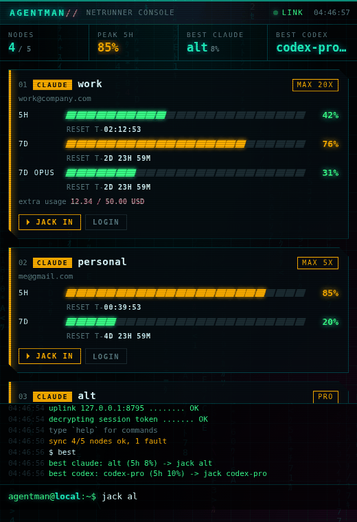

# REDLINE//

> 管理多个 **Claude Code** / **Codex** 账号：同时查看所有账号的额度，自动找到电脑上已有的登录，一键把所有账号登录上线，并且每个账号的网页都在它自己绑定的 Chrome（Google 账号）里打开。

<p align="center"></p>

- **托盘常驻**：程序待在 Windows 任务栏的“显示隐藏的图标”里。图标的圆环表示所有账号中最高的 5h 用量，点开是一个极简的赛博风控制台。托盘图标和任务栏按钮都是开关：控制台在前面时点一下收起，再点一下回来。
- **Claude 和 Codex 分开放**：顶部有两个标签 `CLAUDE·4` 和 `CODEX·2`（Alt+1 / Alt+2 切换），每页只显示一种账号，一行一个，显示 5h 和 7d 额度、重置倒计时 `↻02:13`，以及数据几秒前更新。
- **用完就是用完**：额度到 100% 时整条进度条变成纯红，数字显示为 `MAX`，不闪烁，也不会留下一格让人误以为还有额度。所有百分比一律向下取整（99.6% 显示 `99%`），`MAX` 只在真正用到 100% 时出现；不到 100% 的进度条（包括托盘图标的圆环）也不会显示成满的。
- **自动发现**：`⌕` 或 `scan` 会找出电脑上所有 Claude 和 Codex 的登录。同一个邮箱只登记一次：备份目录、旧副本不会再变成 `邮箱-2` 这样的重复账号。
- **一键登录**：`⚡` 或 `wake` 作用于当前标签页的所有账号。过期 token 自动刷新；需要登录的账号逐个登录，浏览器在该账号绑定的 Chrome profile 里打开。
- **删掉不要的账号**：鼠标移到一行上，点 `✕`，再点一次 `remove?` 确认。删除只是从 redline 里移除，登录文件保留在磁盘上，`scan` 也不会把它加回来。`restore <name>` 可以撤销，`scan all` 可以把删掉的都找回来。
- **自动更新**：exe 会自己检查 GitHub Releases，有新版本就下载、校验 SHA-256、替换自身并重启，不用再手动下载。
- 核心监控功能零依赖（纯 Python 3.11+ 标准库），支持 Windows、macOS 和 Linux。

## 安装

**Windows（不需要 Python）**：从 [Releases](https://github.com/tsljgj/agent-management/releases/latest) 下载 `redline.exe`，放到一个固定的位置，比如 `%LOCALAPPDATA%\redline\`，然后双击运行。第一次启动会自动 `scan` 一遍。之后的版本会**自动更新**，更新时会弹出通知。

> 自动更新的原理：CI 每次在 `main` 上构建通过，就发布一个 `build-<N>` release，附带 `redline.exe` 和 `.sha256` 文件。`claude/*` 分支的构建只发布为 prerelease，不会被自动安装。exe 在启动后约 45 秒检查一次，之后每 6 小时检查一次。发现新版本后，先下载并校验 SHA-256，再把自己改名为 `redline.exe.old`（Windows 允许给正在运行的 exe 改名），把新文件放到原位置并启动它，最后旧进程退出。托盘菜单里可以关掉 **Auto-update**，也可以点 **Check for updates** 手动检查，控制台里对应的命令是 `update`。注意 exe 不要放在 `Program Files` 这种需要管理员权限才能写入的目录。

**从源码安装**：

```bash
pip install -e ".[tray]"     # 不需要托盘的话，pip install -e . 就够了
redline tray                 # 托盘和控制台（Windows 上用 pythonw -m redline tray 可以不弹出黑窗口）
.\scripts\build_windows.ps1   # 自己打包 dist\redline.exe
```

## 快速上手

```bash
redline scan          # 找出电脑上已有的 Claude / Codex 登录并登记（--dry-run 只看不登记）
redline profiles      # 列出 Chrome / Edge / Brave 的 profile 和各自登录的 Google 邮箱
redline wake          # 所有账号上线：刷新过期 token，其余的逐个登录
redline usage         # 在终端里看所有账号的额度
```

账号和 Chrome profile 的对应关系**默认按邮箱自动匹配**：Claude 或 ChatGPT 账号的邮箱等于某个 profile 登录的 Google 邮箱，就算匹配上。对不上时可以手动绑定：

```bash
redline bind claude-work work@gmail.com     # 按 Google 邮箱绑定
redline bind claude-alt "Profile 3"         # 或者按 profile 目录名或显示名
redline bind claude-alt none                # 取消绑定，恢复自动匹配
redline web claude-work                     # 在该 profile 里打开 claude.ai
```

## 控制台

```
REDLINE//   CLAUDE⁴   CODEX¹                           ⚡1   8s   +
work        5h ━━━━━━──────  42%    7d ━━━━━━━━━──  76%
main        5h ━━━━━━━━━━━━  ↻38m   7d ━━─────────  20%
alt         5h ━───────────   8%    7d ━━━━━───────  44%
lab         login ›  token expired
›
```

- 每个账号一行：名字、5h 和 7d 两条进度，以及写在各自进度条下方的**剩余重置时间**（例如 `↻ 2h 07m`、`↻ 2d 20h`；`idle` 表示这个窗口还没开始计时，旁边的 **▶** 可以立即开始计时，见下文）。weekly 额度还有 20% 以上没用、且 36 小时内就要重置的账号，时间会用青色标出，提醒你赶紧用掉。
- 名字下方有一个**油表盘**，显示账号当前的使用速率，按最近 30 分钟 5h 窗口的增长计算。表盘由一格格发光刻度组成，速率越快亮得越多，发光颜色跟着级别变（绿、黄、橙、红、品红），和进度条一样的光效。指针指向当前速率，旁边写着级别（以 5h 窗口为例）：`IDLE`（没在用）、`LOW`（每小时 < 10%）、`MID`（10–25%）、`HIGH`（25–50%，2 小时以上用完）、`HOT`（50–100%，1–2 小时内用完）、`BURN`（每小时 ≥ 100%，1 小时内就会用完，级别文字会闪）。每个级别在表盘上占同样大的一段，所以很快和非常快也能一眼分开。没有 5h 窗口的账号按周窗口折算。窗口够宽时会同时显示具体的 `%/h`；悬停能看到倍速和**照这个速度还有多久用完**。刚启动的几分钟数据不够，暂时不显示。
- **周额度也一起看**：redline 同时量 7d 窗口最近 1 小时的速率，看哪个限制会先用完。周额度比 5h 先用完时，表盘改按周额度算，级别是和**你预期一个账号能用多久**比：预期 2 天就是周额度每小时用 100/48 ≈ 2.1%；按这个比 < 0.5 倍 `LOW`、< 0.8 倍 `MID`、< 1 倍 `HIGH`、< 1.25 倍 `HOT`、< 1.5 倍 `BURN`。
- **爆表**：周额度的速度超过预期的 **1.5 倍**（预期 2 天，照现在的速度 1.33 天内就会用完），表盘就爆表：指针顶过头、刻度闪、往外冒火花，旁边不再写级别，而是写**还有多久用完**（5h 和周额度里先用完的那个）。越快用完越激烈：12 小时以上轻微抖动，2–12 小时抖得更快、文字闪，2 小时内剧烈抖动加频闪。已经用到 MAX 的账号没什么要盯的，表盘是静止、暗下去的样子，写 `OUT`，不做任何动画：动画只留给还需要你注意的账号。
- 预期时长默认 2 天，命令行 `expect 3d` 改所有账号，`expect <名字> 36h` 只改一个（`-` 恢复），展开账号的 `expect` 一行点 ✎ 也能改。设置存在本机。
- 5h 或 7d 额度用完的窗口显示满格红条和 `MAX`，条下面照常是重置倒计时；账号要等的那个窗口（几个都用完时是最晚恢复的那个），倒计时会加粗变亮，名字和油表盘变暗。能用的账号左边有一道绿色细线，最推荐的那个是青色，一眼就能看出现在该用哪个、用完的还要等多久。
- 点一行（任意位置）展开或收起详细信息，展开时有一个短动画，右边的 `›` 会转过来。第一行是一行灰色小字：套餐、邮箱、工作区和绑定的 Chrome。下面依次是 5h/7d 的具体重置时间（并排一行）、其他额度（用读得懂的名字，例如 `7d Fable`、`7d all models`，和 7d 完全一样的那条不再重复）、订阅到期、API credit（本月没有时整行不显示）、最近用过的项目，最后是一排按钮（设为 VS Code 登录、打开网页、连接 Console、改名、删除），鼠标移上去会高亮，删除在最右边。**used in** 只占一行：最近 3 个项目（`●` 表示正在运行，否则是多久之前），点项目名用这个账号打开 VS Code，其余的收在 `+N` 里，悬停可看完整路径。`⋯` 一次展开全部，Esc 全部收起。终端按钮已从卡片上去掉，需要时仍可输入 `jack <name>`。
- 油表盘右边一直显示订阅还剩几天，例如 **`SUB 5d`**：一周以外灰色；最后一周和油表盘一样变色，4–7 天绿色，2–3 天黄色，1 天以内红色。按每月续费推算出来的日期（`~5d`）只是正常续费，始终是灰色，不再变红；只有真实的到期日（Claude 报告的，或你自己填的）才会变色。付费但不知道到期日的显示 `SUB ?`，可以在 PLANS 里填写。悬停可以看到具体日期。Claude 只报告订阅从哪天开始，到期日按每月同一天续费推算，所以写成 `~5d`。Free 账号在这一格显示 `FREE`。Codex 的 banked resets 也一样：最早一张在一周内到期时，`↺ 3` 后面跟上天数（如 `↺ 3 4d`），颜色规则相同。名字下方的这些标记都放在固定宽度的格子里，仪表盘级别、有没有订阅、token 是否过期都不会让它们错位；Codex 免费账号的 `30d` 额度条和 7d 放在同一列。顶部 **PLANS** 标签页把 Claude 和 Codex 分开列出所有订阅的到期日，每组最早到期的排在前面；点 ✎ 或输入 `renew <name> YYYY-MM-DD` 可以填写真实日期。
- **API credit**：Claude Max 和 Team 套餐每月附带一笔 API 额度（Max 5x $100，Max 20x $200，当月用不完作废），存在套餐关联的 Claude Console 组织里，Agent SDK 和 Claude API 能用，Claude Code 不能用。展开账号，在底部按钮里点 **$ 连接 Console**，在弹出的窗口里登录一次 Console（`redline console <name>` 打开的是同一个窗口）。之后名字下方显示本月还剩多少，例如 `$199`（向下取整到美元）：剩 30% 以下变黄，10% 以下变红；还剩 20% 以上、3 天内就要到期时变成青色，提醒你赶紧用掉。悬停可以看到余额和到期日，展开后是 `API credit  $199.99 left / $200.00 · ↻ 11-21 27d`（悬停看已用多少）。上个月那笔到期、新的一笔还没到账时不再占位置，名字下方和详情里都不显示。读取失败时继续显示上次的数字并标明“未更新”，2 分钟后重试；Console 前面的防护偶尔会对没有 User-Agent 的请求返回网页形式的 403，这种情况不再被当成登录失效。余额正常时最多每 10 分钟读一次。Console 的登录只保存在本机（`~/.redline/console/`，每个账号的登录窗口也各用一个独立目录），只用来读余额，不会显示，也不写进日志。窗口里登录的如果不是这个账号，redline 会拒绝保存。登录过期后按钮变成 **重新连接**。
- Codex 的 **打开网页** 进入 `chatgpt.com` 聊天首页，**用量** 单独打开额度页，两个入口都会使用该账号绑定的 Chrome profile。不同记录若登录了同一 ChatGPT 账号，详情会标明 **共享额度**，不能把它们当作两份额度。
- Codex Free 等只有一个额度窗口的账号会按接口实际返回的时长显示；没有返回窗口时明确显示“未返回额度窗口”。仪表盘右侧简洁显示额外额度（如 `12.5 cr`）和 **Banked resets** 次数（如 `↺ 3`），悬停可看说明。展开账号可查看每张可用重置券的到期时间（本地时区）和剩余时长，按最早到期排序；终端 `redline usage` 也会逐条列出日期。缺失日期明确显示未知，明细获取失败或接口仅返回部分记录时会提示，不影响已取得的额度和次数，也不会把缺失字段当作 0。
- 如果记录的预期邮箱与实际登录邮箱不同，会显示**登录账号不符**并提供重新登录入口，不把其他账号的额度当作该邮箱的额度。此时需要用预期邮箱重新登录；普通同步不会替你更换登录。
- Codex 的 weekly 会区分 **计时中 / 未开始 / 待确认 / 无周额度**。0% 但有未来重置时刻仍是计时中；旧缓存、查询失败、已过期的重置时间和字段缺失不会直接判为未开始，窗口时长缺失也不会直接判为无周额度。**未开始和待确认**都会进入顶部汇总及标签提醒；weekly 排序把未开始和实时用量为 0% 的待确认账号放在前面。实时查询确认未开始或仍待确认时，托盘会给出对应通知；未解决的状态每 24 小时再次提醒一次，不会每次同步都弹窗。提醒时间会跨重启保存，确认计时已开启后清除；从待确认变成确认未开始会立即提醒。
- 未开始账号 weekly 进度条下方的 `待启动` 旁有一个 **▶**，点击后通过官方 Codex SDK 发送一次极短请求，消耗少量订阅额度，再查询用量核验是否出现未来 weekly 重置时刻。状态待确认且用量为 0% 时，`待确认` 旁也有 **▶** 可以尝试；请求完成不等于计时已经确认，详情里的「开启计时」一行显示核验结果。它使用所选账号，不切换默认登录。
- `⇅` 切换排序：**默认（付费账号优先）** → **weekly 最快重置**（还能用的排前面，已用满和需要登录的排最后）→ 5h 剩余最多 → 名字。默认排序把付费账号放在免费或套餐未知的账号前面，同组保持原有顺序；其他排序方式仍按各自规则排列。选择会被记住。
- 额度用完时，整条变成纯红，数字位置显示**什么时候恢复**，比如 `↻38m`。
- 青色的名字表示当前页 5h 剩余额度最多的账号。
- 右上角：
  - `⚡N`：只在有账号需要登录、或 token 已过期时出现，点一下把它们都恢复上线：先续期，续不上的再登录。token 过期的账号仍显示上次的用量（变暗），名字下方有 `⟳ renew`，只恢复这一个；已被登出的显示 `login ›`。手动点的续期不受限流等待期限制，立即尝试。
  - `8s`：距上次同步的时间，悬停可以看到同步时刻和下次同步倒计时，点击立即同步。
  - `⋯`：展开所有行的详细信息，包括邮箱、套餐、5h/7d/opus 各自的具体重置时间、extra usage、绑定的 Chrome profile、同步时间、错误信息和登录目录。只想看某一个账号的话，直接点那一行的空白处。
  - `b5`：当前版本号，点一下就检查更新；有新版本时会变成高亮的 `↑b6`，点击后自动下载、校验、安装并重启。
  - `+`：添加账号。
- `+` 面板里可以：
  - 恢复删掉的账号；
  - 选一个还没用过的 Chrome Google 账号，直接新建、绑定并登录；
  - 扫描本机已有的登录；
  - 或者输入一个名字新建账号。
- 账号默认以**登录邮箱**命名，由 scan、`+` 面板或自动迁移生成的名字都是如此。自动命名会补全登录邮箱；Codex 已指定预期邮箱的记录若登错账号，会保留原名并提示身份不符。同一个邮箱在 Claude 和 Codex 下可以同名；在命令行里有歧义时，用 `claude:邮箱` 或 `codex:邮箱` 指明。
- **◆ use in VS Code** 把账号的登录移进 `~/.claude` / `~/.codex`，VS Code 和直接运行的 `claude` / `codex` 都用它。如果之后在 VS Code 的 Codex / Claude 面板里退出再登录，或者在终端里运行 `codex login`，换进去的是浏览器当时登着的那个账号。redline 每次同步都会核对：发现被换了号，「默认」标记就跟到实际登录的账号上（没登记过的会新建一张），原来那个账号提示需要重新登录，控制台日志里也会报警。切换时不会再把别人的登录存进原账号的目录。账号目录里的登录和它的邮箱对不上时，不能设为默认。被覆盖前可能是唯一一份的登录，会先备份到 `~/.redline/stash/`。
- 改名也可以直接**双击名字**，按 Enter 保存、Esc 取消。改名只改显示名，登录和 Chrome 绑定都不受影响。命令行对应 `rename <旧名> <新名>` 或 `redline mv <旧名> <新名>`。
- 双击 `redline.exe` 总会打开控制台：如果它已经在后台运行，会把现有的窗口叫出来；如果旧进程卡死了（比如早期版本更新失败留下的），会先问你要不要重启它。开机自启时只在托盘里待着，不弹出窗口。
- 窗口可以拖**任意边或角**自由缩放，最小 300×160。拖左右边改的宽度会一直保留；高度默认跟着内容（账号数量、展开的行、日志）自动变化，**顶边不动，只往下长、往下缩**，到屏幕底部为止，再多就在列表里滚动。拖过上下边之后，高度就按你拉的来，不再自动变；输入 `fit` 可以恢复自动高度。只有 logo 和顶栏的空白处能拖动窗口，按标签或顶栏按钮不会带动窗口。窄屏会自动变布局：先隐藏 logo，再把每行拆成两行；很矮的时候会隐藏命令行。
- 底部的 `›` 是命令行，给喜欢用键盘的人，所有操作也都有按钮。输入命令时才会展开日志，按 Esc 收起。输入 `help` 可以看全部命令。

托盘右键菜单包括：

- Web ▸ 和 Jack in ▸：按账号选择
- Refresh now
- Scan for accounts
- Wake all
- Auto-refresh expired tokens：开关
- Check for updates
- Auto-update：开关
- Start with Windows：开机自启
- Quit

用量越过 80% 或 95% 时会弹出 Windows 通知。

## 一键登录是怎么做的

1. **Token 过期，但有 refresh token**：直接刷新并写回凭据文件，不需要浏览器。刷新前会先拿到和 Claude Code 自己一样的锁（`<配置目录>.lock`），拿到锁后重新读一次文件。如果 CLI 刚好已经刷新过，就不再重复刷新，避免 refresh token 轮换导致 CLI 被登出。
2. **没有登录**：Codex 由 redline 自己完成 ChatGPT 登录，流程和 `codex login` 相同，**不需要安装 Codex CLI**。Claude 在后台运行 `claude auth login --claudeai --email <profile 的邮箱>`，同时设置 `BROWSER=redline`。CLI 要打开浏览器时会调用 redline，redline 再用 `chrome --profile-directory=<该账号的 profile>` 打开授权页。授权完成后回调到 localhost，**不需要复制粘贴任何东西**。
3. 等到凭据文件出现新的 token，再去读登上的邮箱。如果和另一个账号重复，或者和绑定 profile 的邮箱不一致，就报警。然后继续登录下一个账号。

## Claude 5h 一键开始

Claude 的 5h 窗口从第一次请求才开始计时。账号已登录、5h 显示 `idle`、周额度没用完时，5h 进度条下方的 `idle` 旁有一个 **▶**；终端里对应 `redline start <name>`。

它用本机安装的 Claude Code，以这个账号的订阅登录（`CLAUDE_CONFIG_DIR` 指向它的登录目录，默认账号不设）在一个临时空目录里跑一次 `claude -p "hi" --model haiku`：不带任何工具、设置、hooks、插件、MCP 和 skills，也不保存会话。子进程不继承 `ANTHROPIC_API_KEY` 等 API key 或 token（只有订阅用量才会开始 5h 计时），也不用 `--bare`（它不认 OAuth 登录）。请求最多等 90 秒，期间持有这个登录目录的锁；同一个登录同时只跑一个。结束后重查用量，出现 5h 重置时间才算成功，提示 `5h 计时已开始` 和倒计时；失败时显示简短原因，比如周额度已用完时 CLI 给出的提示。

## Codex weekly 一键启动

`wake` 用于登录或续期；启动 weekly 需要一次实际的 Codex 请求。官方文档提供 [Codex SDK](https://learn.chatgpt.com/docs/codex-sdk) 和 [额度查询字段](https://learn.chatgpt.com/docs/app-server)，但没有单独的“开启 weekly countdown”开关，也没有保证一次请求后一定立即返回周重置时刻。因此 redline 以查询结果为准，不在本地伪造七天倒计时。

点击按钮需 Node.js 18+ 和 npm。首次使用会将固定版本的 `@openai/codex-sdk` 安装到 `~/.redline/codex-sdk`（设置了 `REDLINE_HOME` 则使用对应目录），后续复用；SDK 自带所需 Codex 运行时。此依赖仅用于这个按钮，日常额度监控仍使用 Python 标准库。

请求在临时空目录和隔离配置中运行，使用所选账号的 ChatGPT 登录，不继承 API key、自定义 provider 或项目配置。提示词只要求回复 `OK`，关闭工具和联网能力，使用只读权限。重复点击及同一 ChatGPT 身份的并发请求会被拦住；请求有超时，完成后只重查额度，不自动重复发送模型请求。登录失效、安装失败或无法确认计时时，会显示可诊断的结果。

> 旧版 Claude Code 没有 `claude auth login`，会退回为打开一个终端执行 `/login`。Codex 在 Windows 和 macOS 上不认 `BROWSER`，所以 redline 会读取它打印的授权链接，在正确的 profile 里打开。但 Codex 自己也会在默认浏览器里再开一个标签页，关掉那个就行。

## 原理

| Provider | 目录环境变量 | 凭据 | 用量接口 |
|---|---|---|---|
| Claude | `CLAUDE_CONFIG_DIR` | `.credentials.json`（macOS 在 Keychain `Claude Code-credentials-<hash>`） | `GET https://api.anthropic.com/api/oauth/usage` |
| Codex | `CODEX_HOME` | `auth.json` | `GET https://chatgpt.com/backend-api/wham/usage` |

这两个接口就是 `claude` 的 `/usage` 和 `codex` 的 `/status` 背后调用的接口，返回的百分比和官方显示的一致。

## 其它命令

```bash
redline usage [names] [--json]     # 终端表格或 JSON
redline watch -n 120               # 每 2 分钟刷新一次
redline serve                      # 在浏览器里打开同一个控制台 http://127.0.0.1:8765
redline add claude work / redline rm exp1 exp2 / redline restore exp1
redline run work -- --resume       # 以 work 账号运行 claude
redline start work                 # 立即开始 work 的 Claude 5h 计时（发一条最短的请求）
redline console work               # 连接 work 的 Claude Console，显示每月 API credit
eval "$(redline env work)"         # 在当前 shell 切换到 work 账号
```

## 工作区（`redline ws`）

一个工作区由一个名字、若干仓库、每个 provider 一个登录目录和一个 VS Code Profile 组成。例如 quant 仓库在 `quant` Profile 里打开，Claude 用 `D:\claude-config-quant` 的登录。目前只读：redline 只看、只报告，不移动任何登录。

```bash
redline ws list                 # 所有工作区：Profile、仓库、各 provider 登录的账号
redline ws status [ws] [--json] # 账号、5h/7d 和漂移；在仓库里运行时只显示当前工作区
redline ws scan [--dry-run]     # 重新发现，报告差异
```

- **发现**：读 `~/.claude/profiles.json`（`claude_profile.py` 的登记表）和 VS Code 的 Profile（`storage.json` 的 Profile 列表与文件夹关联，各 Profile `settings.json` 里的 `claudeCode.environmentVariables` / `terminal.integrated.env.*`）。没设变量的 Profile 归 `default`；`.claude-experiment*` 目录不算工作区。这些文件 redline 只读不写。
- **登记表**：`~/.redline/workspaces.json`，首次使用时自动扫描生成。手动改过的工作区加上 `"user": true`（或者只锁某几项，如 `"user": ["repos"]`），之后 `scan` 不会覆盖，只报告差异。
- **谁登在哪**：Claude 读该目录 `.claude.json` 里的邮箱（默认目录读 `~/.claude.json`），Codex 看哪个账号的登录在那个目录里，然后按邮箱对应到 redline 的账号。不读 token。额度用最近一次同步的缓存，`--fetch` 才会现查。
- **漂移**：工作区目录没有登录；仓库在别的 Profile 里打开（例如 OSWorld 在 Default 里打开）；Profile 里还开着别的文件夹（`+N folders`）；两个工作区登的是同一个账号（共享额度）；Profile 指向别的目录或者不存在。每条都附一行修复命令。
- **控制台**：展开账号可以看到它的登录在哪些工作区；有漂移时，顶部出现一行提示，只显示第一条，其余收在右边的 `+N ▾` 里，点这一行展开全部、再点收起（会记住）；悬停每一条看怎么修。

## 注意

- 控制台只监听 `127.0.0.1`。每次启动会生成随机 token，并校验 Host 头，所以其他网页无法借本地端口去开终端或浏览器。
- Claude 用量接口的限流比较严格，默认每 120 秒同步一次（`-n` 可调），手动刷新至少间隔 15 秒。被限流时继续显示旧数据；接口给了 Retry-After 的，到点之前不再请求这个账号（Free 账号常见，约 20 分钟）。
- Claude 的套餐按 profile 接口的实时结果显示：每 30 分钟重新读一次，手动同步（点 ⟳）时立即重读；本地凭据里的套餐信息变化、或用量接口的结果和缓存的 Free/付费状态对不上时，也会马上重读，所以换订阅后最多一个同步周期就会更新。`.credentials.json` 里的 `subscriptionType` 只记着登录那天的套餐，续期 token 不会更新它；以前 Max 退订变成 Free 后仍显示 Max，升级后仍显示旧套餐。Free 账号显示 `FREE`，默认排序排在付费账号后面。Claude Free 套餐不含 Claude Code，用量接口会拒绝（403 `oauth_not_allowed_for_organization` 或 429）。这时这一行显示“不含 Claude Code ↗”，不提示重新登录，也不算进 ⚡，因为 token 本身没问题，wake 和重新登录都改变不了。旧套餐时期的用量数字也不再显示。
- Claude 用量接口返回的百分比在 redline 里统一减 1 显示（低于 1% 显示 0%，用满的 100% 仍显示 MAX）。这是一个校准值（`providers/claude.py` 里的 `PERCENT_OFFSET`），如果以后对不上可以改回 0。
- **Gemini**：本机有 Gemini CLI 的 Google 登录（`~/.gemini/oauth_creds.json`）时，会多出一个 **GEMINI** 标签页（只有找到登录时才出现），每个登录一行：pro 和 flash 两条额度（同一系列取剩余最少的模型），名字下方显示套餐（如 `AI PRO`），展开后有邮箱、项目、各模型剩余百分比和重置时间。额度来自 Gemini CLI 自己用的 Code Assist 接口（`loadCodeAssist` / `retrieveUserQuota`），只读不写；access token 过期时用 Gemini CLI 安装包里的 OAuth client 在内存中续期，不写回文件。续期失败时提示在终端运行一次 `gemini`。登录、改名、删除都在 Gemini CLI 里进行，这里不提供。多个 Gemini 登录可以在 `config.json` 的 `settings.gemini_homes` 里列出目录。`Alt+数字` 按屏幕上标签的顺序切换。
- 托盘和 `serve` 默认开启 auto-refresh，也就是自动刷新过期 token，可以在托盘菜单里关掉。`redline usage` 默认只读，需要刷新时加 `--refresh-tokens`。
- Claude 的 access token 大约 8 小时过期，redline 会自己续期，没在用的账号也不用重新登录。续期请求要带和 Claude Code 一样的 User-Agent（`axios/…`）：token 接口对 `claude-code/2.1.0` 一律返回 429，早期版本因此一直续期失败。如果真的被限流，redline 会等一段时间再试（遵守 Retry-After，没有就等 30 分钟），期间继续显示这个账号**上次拿到的用量**（重启、自动更新后也会保留）。如果某个窗口的重置时间已经过了，就显示为已重置。
- refresh token 本身大约在登录 30 天后失效（凭据里的 `refreshTokenExpiresAt`），续期不会延长这个期限。到期后只能重新登录一次，这是服务器的规定。
- 存在 macOS Keychain 里的 Claude 凭据不会被改写，需要在该账号下运行一次 `claude` 让它自己刷新。
- 如果 Codex 配置了 `cli_auth_credentials_store = "keyring"`，本工具目前读不到它的 token。
- 旧版 Windows 10 上控制台窗口打不开的话，需要安装 [WebView2 Runtime](https://developer.microsoft.com/microsoft-edge/webview2/)。exe 没有代码签名，SmartScreen 可能会拦截，点“仍要运行”即可。
- 配置保存在 `~/.redline/config.json`（可以用 `REDLINE_HOME` 修改）。旧的 `~/.agentman` 会被自动沿用。

## 类似项目调研（2026-09）

| 项目 | 形态 | 多账号 | Claude | Codex | 说明 |
|---|---|---|---|---|---|
| [steipete/CodexBar](https://github.com/steipete/CodexBar) | macOS 菜单栏 | ✓（token accounts） | ✓ | ✓ | 最成熟，支持几十个 provider，**仅限 macOS** |
| [f-is-h/Usage4Claude](https://github.com/f-is-h/usage4claude) | macOS 菜单栏 | ✓ | ✓ | ✓ | 支持多个 Claude 账号和组织，也支持 Codex |
| [crandrosoff/clauth](https://github.com/crandrosoff/clauth) | CLI / TUI / MCP | ✓ | ✓ | ✗ | 切换 Claude 账号，快到上限时自动切换，**只支持 Claude** |
| [CodeZeno/Claude-Code-Usage-Monitor](https://github.com/CodeZeno/Claude-Code-Usage-Monitor) | Windows 任务栏 | ✓ | ✓ | ✓ | **仅限 Windows** |
| [jens-duttke/usage-monitor-for-claude](https://github.com/jens-duttke/usage-monitor-for-claude) | Windows 托盘 | 每个账号开一个进程 | ✓ | ✗ | |
| [Maciek-roboblog/Claude-Code-Usage-Monitor](https://github.com/Maciek-roboblog/Claude-Code-Usage-Monitor) | 终端 | ✗ | ✓ | ✗ | 通过本地 jsonl 日志估算 token，**不是**官方百分比 |

本项目的定位：**跨平台（包括 Linux 和远程服务器）的 CLI + Web**，同时支持 Claude 和 Codex 的多账号。可以用 JSON 接入其他工具，也可以跑在一台服务器上集中看所有账号。

## 开发

```bash
pip install pytest && python -m pytest -q
```

## Roadmap

- [x] 快到上限时提醒（Windows 通知）
- [ ] 提醒推送到 webhook / Telegram
- [ ] 记录用量历史并画趋势图（SQLite）
- [ ] 自动推荐或切换到剩余额度最多的账号（`redline pick claude`）
- [x] Gemini CLI 额度（只读）
- [ ] 支持 Cursor / Copilot 等更多 provider
